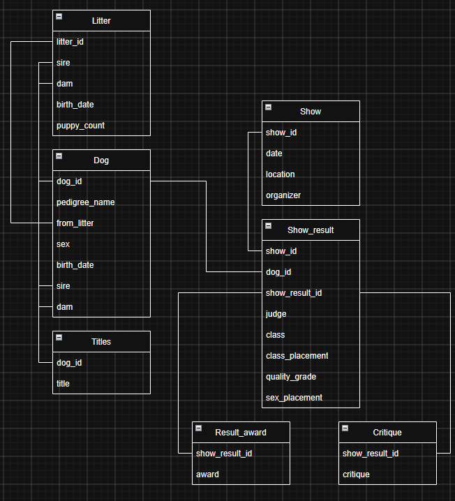

# DogChat

Full disclosure, the frontend is **100% AI-generated**. However, the LangChain agent, database design, and database setup are my own work.

## Deploy to Render with Azure SQL

[Open DogChat](https://dogchat-2y4h.onrender.com)

DogChat runs as a Dockerized application on **Render**, with its relational records hosted in **Azure SQL Database**. A FastAPI server serves the web interface and chat API together, while the LangChain agent calls OpenAI models and accesses Azure SQL through SQLAlchemy and Microsoft ODBC Driver 18.

## About DogChat

DogChat answers factual questions about pedigree dogs using pedigrees, breeding history, held titles, and show results. Users can explore connected records through a conversation rather than looking up each dog individually.

It can answer questions such as:

- Who are a dog's parents and littermates?
- Which breeding litters are recorded for a dog, and how many puppies were in those litters?
- Which dogs hold a title, or a combination of titles?
- Which shows took place at a particular location or within a given year?
- At which shows did a dog receive Best of Breed or other awards?
- What judges, classes, quality grades, and placements are recorded for a dog's show appearances?

A database panel provides a separate view of selected records, allowing users to inspect the underlying data when assessing an answer. Its four featured dogs is not the limit however - DogChat can answer questions about all dogs and all shows in the database.

Semantic search over written show critiques is planned but is not part of the current application.

## How the agent works

The application uses LangChain, an OpenAI chat model, and seven explicitly defined tools. It selects tools and follows relationships across their results: a question about a dog's offspring can require finding the dog, retrieving its breeding litters, and then retrieving the dogs linked to those litters.

Database access is implemented through **SQLAlchemy Core queries**, with **Pydantic schemas** defining structured results. The model supplies arguments to predefined tools rather than generating arbitrary SQL. Tools support, among other capabilities, batched lookups, name searches, title searches, and show-result filtering by dates, placements, and awards.

Custom middleware uses a separate structured LLM review to detect internal identifiers in proposed final answers and request corrections.

## Database architecture

The SQL Server schema separates dog identity and family relationships from show participation and competition outcomes. Seven tables represent these distinct concepts:

| Table | Role |
| --- | --- |
| `Dog` | Pedigree name, sex, birth date, recorded parents, and birth-litter reference. |
| `Litter` | A breeding litter's parents, birth date, and recorded puppy count. |
| `Titles` | Held titles associated with a dog. |
| `Show` | A show's date, location, and organizer. |
| `Show_result` | A dog's result in a show class, including judge, quality grade, and placements. |
| `Result_award` | Awards associated with a specific show result. |
| `Critique` | Written critique text associated with a show result, reserved for future semantic search. |

The diagram shows the logical relationships represented by the identifier columns.

The implementation is organized across [`src/agent.py`](src/agent.py), [`src/tools.py`](src/tools.py), [`src/functions.py`](src/functions.py), and [`src/schemas.py`](src/schemas.py).
